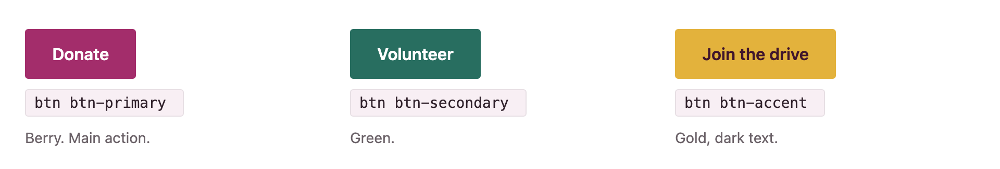
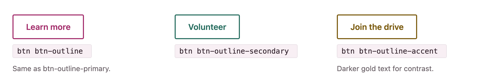
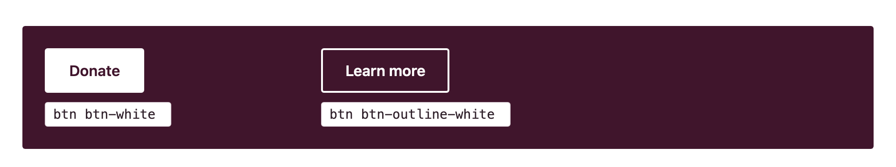
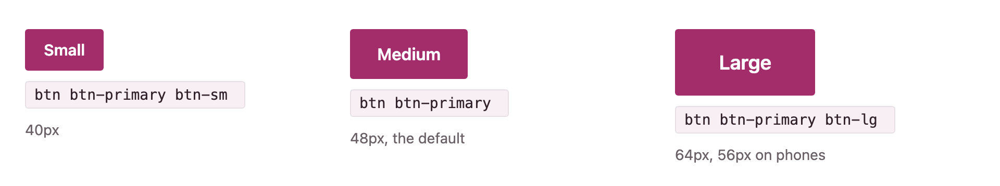
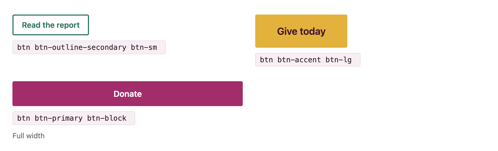

# Buttons

Button styles for Button blocks and theme templates. The styles live in `assets/css/components/buttons.css`.

To try them in a browser, with hover and keyboard focus, open [`buttons-preview.html`](buttons-preview.html) from your local copy of the repo. It loads the theme's CSS directly, so it always matches the site. GitHub only shows its source code.

## How to use them

**In the editor (Button block)**

1. Select the button.
2. In the sidebar, open **Advanced**.
3. In **Additional CSS class(es)**, type the classes, for example `btn btn-primary`.
4. Leave the block's own color settings empty, because they override these classes.

**In theme templates**

```html
<a class="btn btn-primary btn-lg" href="/donate/">Donate</a>
<a class="btn btn-outline btn-lg" href="/volunteer/">Volunteer</a>
```

## Classes

Always use `btn`, then one color, then optionally a size and a width.

| Group | Classes |
|---|---|
| Base | `btn` (required) |
| Solid color | `btn-primary` (berry, the default) · `btn-secondary` (green) · `btn-accent` (gold) · `btn-white` |
| Outline color | `btn-outline` (berry) · `btn-outline-primary` · `btn-outline-secondary` · `btn-outline-accent` · `btn-outline-white` |
| Size | `btn-sm` (40px) · `btn-md` (48px, the default) · `btn-lg` (64px, or 56px on phones) |
| Width | `btn-block` (full width) |

A Button block set to the editor's **Outline** style looks the same as `btn-outline`.

## Solid

Use these for the main action in a section, with one solid button per group.



## Outline

Use these for the second action next to a solid button. On hover they fill with their color.



## On dark or photo backgrounds



## Sizes

Medium is the default. Use large for the home hero and other actions that open a page.



## Combining

You can use any color with any size.



## Hover and focus

- Solid buttons turn a little darker on hover. Outline buttons fill with their color. There's no underline, shadow or motion.
- Keyboard focus shows a 3px outline.

## Adding a color

To add a color named `x`, add one rule to `buttons.css` that covers both the solid and the outline class:

```css
.btn-x,
.btn-outline-x {
	--btn-color: …;        /* fill */
	--btn-color-hover: …;  /* fill on hover, a little darker */
	--btn-on: …;           /* text on the fill: at least 4.5:1 against both fills */
	--btn-ink: …;          /* outline border and text (optional) */
}
```

Any class that starts with `btn-outline` gets the outline style automatically. Then add the new color to `buttons-preview.html` and this page.

## Old classes

`btn-brand-1` (orange) and the footer newsletter link are listed under **LEGACY** in `buttons.css`. Delete them once no page uses them.
